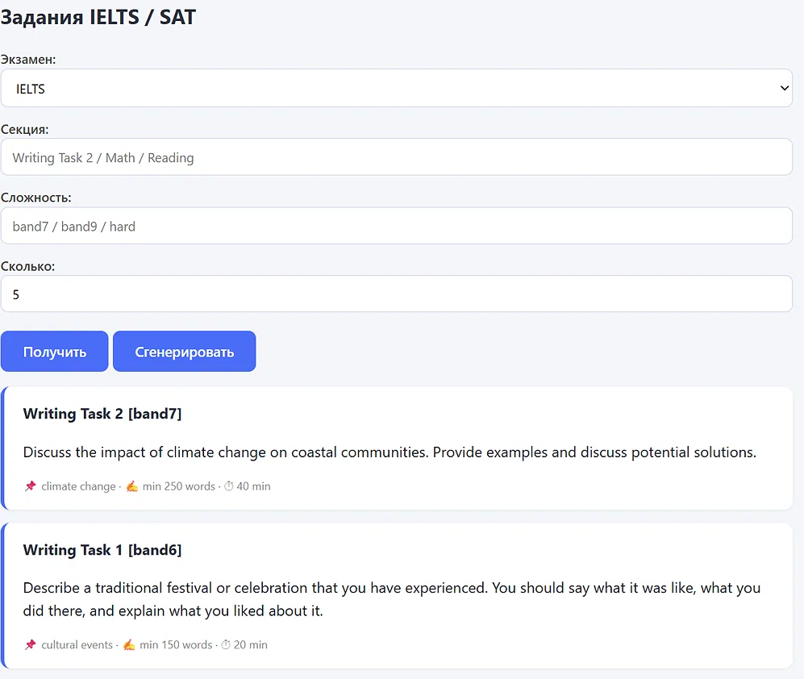
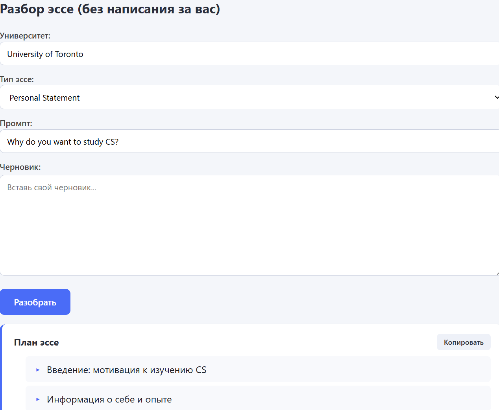
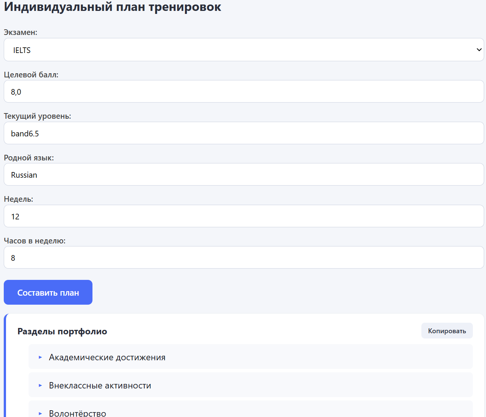
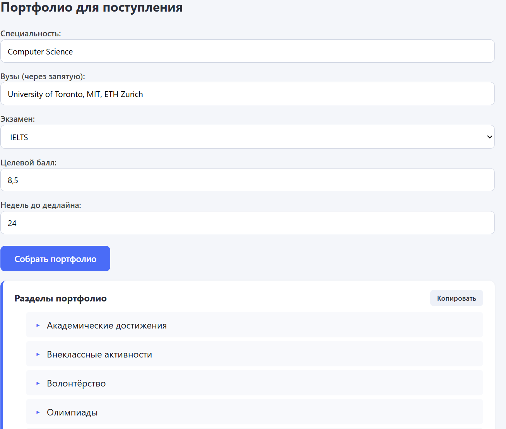
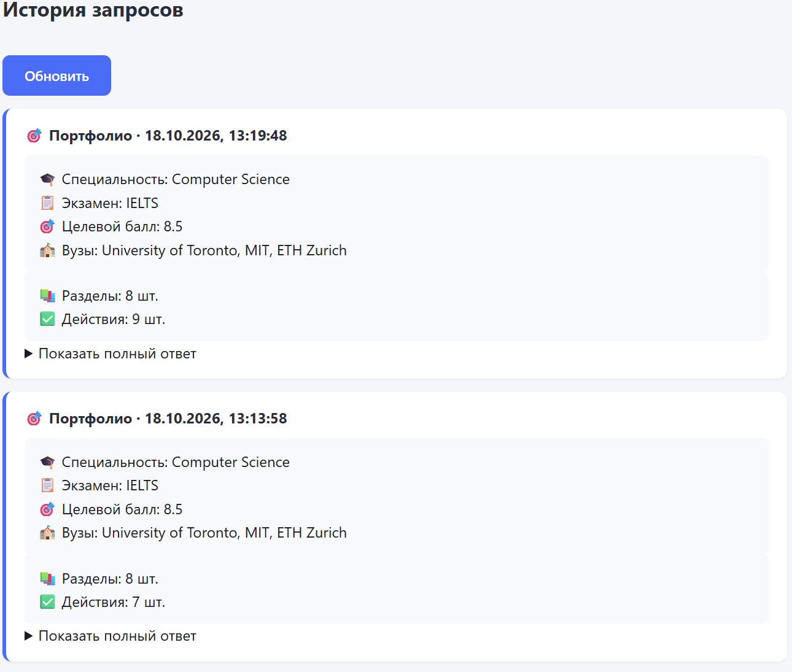

# 🎓 AI Coach — IELTS / SAT / Поступление

Локальный AI-тренажёр для подготовки к IELTS / SAT и поступления в зарубежные вузы. Работает на C++ + Ollama, без облачных API и без оплаты за токены.

## Возможности

- 📚 **Задания IELTS / SAT** — 30 IELTS + 20 SAT + генерация новых через LLM (сколько попросит пользователь)
- ✍️ **Эссе-коуч** — разбор черновика без «написания за вас»: план, вопросы для рефлексии, чек-лист университета, слабые места
- 🗓 **План тренировок** — индивидуальный план до 9.0 IELTS с учётом родного языка и часов в неделю
- 🎯 **Портфолио** — разделы и действия для поступления в конкретные вузы
- 📜 **История запросов** — все запросы сохраняются в SQLite
- 🌐 **RU / EN** — переключатель интерфейса и контента от LLM

## Скриншоты

### Задания


### Эссе-коуч


### План тренировок


### Портфолио


### История


## Стек

- **C++17** — сервер на `cpp-httplib` + `libcurl` + `sqlite3`
- **nlohmann/json** — работа с JSON
- **Ollama** + `qwen2.5:7b` — локальная LLM на GPU
- **HTML / CSS / JS** — фронт без фреймворков

## Требования

- Windows 10/11
- MSYS2 (UCRT64) с `g++`, `cmake`, `libcurl`, `nlohmann-json`, `sqlite3`
- Ollama с моделью `qwen2.5:7b`
- NVIDIA GPU (опционально, но рекомендуется)

## Установка и запуск

### 1. Ollama

Скачать с https://ollama.com, установить, затем:

```powershell
ollama pull qwen2.5:7b